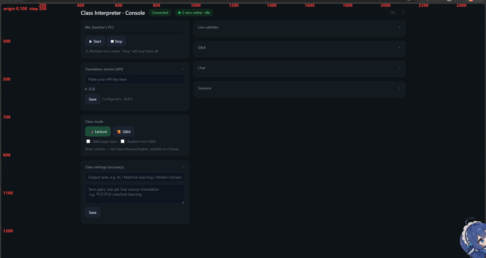
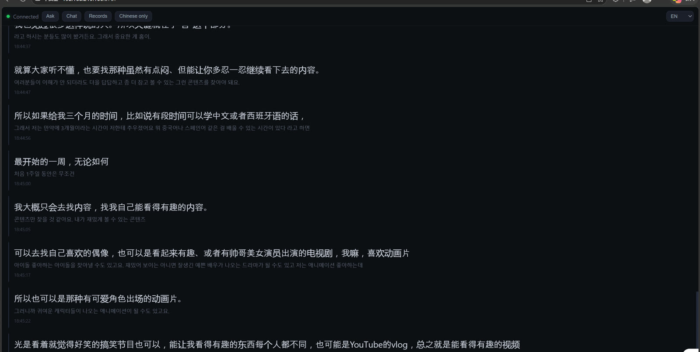

# Class Translator

**Real-time Korean → Chinese subtitles for classroom lectures.**

One computer acts as the host (audio capture + speech recognition + translation + web serving). Students scan a QR code and read live subtitles on their phones. Supports lecture mode (Korean/English → Chinese), student Q&A (Chinese → Korean), a classroom chat room, and per-session records.

Speech recognition runs locally with [whisper.cpp](https://github.com/ggml-org/whisper.cpp) (offline, free). Translation uses an LLM API (default: DeepSeek; any OpenAI-compatible endpoint works).

## Pages

| Page | Who | What |
|---|---|---|
| `/host` | Teacher (or your laptop) | Captures audio, auto-splits sentences, shows QR code |
| `/` | Students | Live subtitles, Q&A, chat room (images allowed) |
| `/admin` | You | Console: remote start/stop teacher's mic, switch modes, view everything |
| `/talk` | Students (optional) | Minimal Q&A page only |





## Quick start (Windows)

1. Install [Node.js](https://nodejs.org/) 20+
2. Download three external files (details in the Chinese section below):
   - whisper.cpp binaries → `bin/whisper/Release/`
   - `ggml-base-q5_1.bin` → `models/`
   - `cloudflared.exe` → `bin/`
3. Run `npm install`
4. Double-click `启动.bat` (or `node start.mjs`)
5. Open `http://localhost:8787/admin` and paste your API key
6. Open `http://localhost:8787/host`, allow microphone, share the QR code

A Cloudflare quick tunnel starts automatically and provides a public HTTPS URL (mobile browsers require HTTPS for microphone access). The URL changes on each launch.

## Tech stack

- **Backend**: Node.js (native `http` + `ws`, no framework)
- **ASR**: whisper.cpp (C++ inference, BLAS)
- **Translation**: DeepSeek Chat API (OpenAI-compatible; base URL and model are configurable)
- **Tunnel**: Cloudflare Tunnel
- **Frontend**: vanilla HTML/CSS/JS — Web Audio capture, energy-based VAD, Canvas image compression

## License

MIT

---

# 课堂同传 · Class Translator

**韩国老师用韩语（偶尔英语）讲课，学生用手机扫码看中文实时字幕。**

一台电脑当主机（收音 + 识别 + 翻译 + 提供网页），学生扫二维码就能看。支持老师讲课（韩/英→中）、学生提问（中→韩）、课堂聊天室、课程记录回看。

识别在本地跑（whisper.cpp，离线、不要钱），翻译走大模型 API（默认 DeepSeek，也可换成任何 OpenAI 兼容接口）。

---

## 它长什么样

| 页面 | 谁用 | 干什么 |
|---|---|---|
| `/host` | 老师（或你的电脑） | 录音、自动切句上传，显示二维码 |
| `/` | 学生手机 | 看实时字幕、提问、聊天室（可发图） |
| `/admin` | 你 | 控制台：远程开会/停止老师收音、切模式、看所有内容、管课程记录 |
| `/talk` | 学生（可选） | 只提问的极简页 |


---

## 架构

```
老师电脑浏览器(录音)
      │  WebSocket 音频（16k WAV 分段）
      ▼
  本机 Node 服务 ──► whisper.cpp 识别 ──► 翻译 API ──► WebSocket 广播
      │                                                        │
      └────────── Cloudflare 隧道（公网 https）────────────────┘
                                    │
                              学生手机扫码
```

- 识别和翻译都在**主机这台电脑**上完成，学生手机只负责显示，所以手机不需要装任何东西。
- 公网地址通过 Cloudflare 快速隧道自动生成（每次启动会变），解决了「手机浏览器录音必须 https」的问题。

---

## 快速开始（Windows）

### 1. 装依赖

- [Node.js](https://nodejs.org/) 20 或更高
- 在项目目录执行：`npm install`

### 2. 下载三个外部文件（不进 Git，需要自己下）

| 文件 | 放哪 | 下载 |
|---|---|---|
| whisper.cpp 运行时 | `bin/whisper/Release/` | [ggml-org/whisper.cpp releases](https://github.com/ggml-org/whisper.cpp/releases) → `whisper-blas-bin-x64.zip`，解压后把 `Release` 整个目录放进来 |
| 语音模型 | `models/ggml-base-q5_1.bin` | [huggingface.co/ggerganov/whisper.cpp](https://huggingface.co/ggerganov/whisper.cpp) 下载 `ggml-base-q5_1.bin`（约 60MB） |
| cloudflared | `bin/cloudflared.exe` | [cloudflare/cloudflared releases](https://github.com/cloudflare/cloudflared/releases) → `cloudflared-windows-amd64.exe`，改名 `cloudflared.exe` |

> 模型可选：`ggml-small-q5_1.bin`（190MB）识别更准但慢一倍；`ggml-base-q5_1.bin`（60MB）延迟最低。

### 3. 配置

复制 `config.example.json` 为 `config.json`，然后启动后在**控制台**里填 API Key（不用手改文件）。

### 4. 启动

双击 `启动.bat`（或 `node start.mjs`）。它会：

1. 起 Cloudflare 隧道，拿到公网 https 地址
2. 把地址写进 `config.json`
3. 起翻译服务（端口 8787）

### 5. 用

- 打开 `http://localhost:8787/admin` —— 你的控制台，从左列「翻译服务」里填 API Key
- 打开 `http://localhost:8787/host` —— 老师端，选麦克风，点开始
- 学生扫码（host 页上显示二维码），或用公网地址打开 `/`

---

## 功能

- **两段式翻译**：先出快稿（约 1.5–2 秒看到中文），再用完整上下文精修一版
- **自动切句**：安静 550ms 判定一句结束，过短的丢弃，环境噪音过滤
- **幻觉抑制**：黑名单短语 + 置信度 + 语言白名单，静音不会冒出「请点赞订阅」
- **术语表**：控制台里填课程领域和术语对照，注入给翻译（如 `머신러닝=机器学习`）
- **中韩双向**：讲课模式韩→中；切到「学生提问」后，麦克风收中文→译韩语
- **学生语音提问**：学生用自己手机说话，服务器识别后广播（需先在控制台开放）
- **聊天室**：中韩互译，支持发图
- **课程记录**：每节课一个 JSON 文件，可回看、可「继续上一节」

---

## 常见问题

**手机打不开 / 没法录音？**
必须用 https 地址（即隧道给的公网地址）或 localhost。局域网 IP 的 http 页面浏览器会禁用麦克风。

**微信里能用吗？**
能。看字幕、发语音提问都可以（实测微信里也能录音发送）。不过微信内置浏览器限制稍多一点，用手机自带浏览器（Safari / Chrome）打开体验更稳。

**识别慢？**
CPU 上 base 模型约 1.3 秒/句；有 NVIDIA 显卡可自行编译带 CUDA 支持的 whisper.cpp（老显卡需注意 CUDA 版本）。

---

## License

MIT
